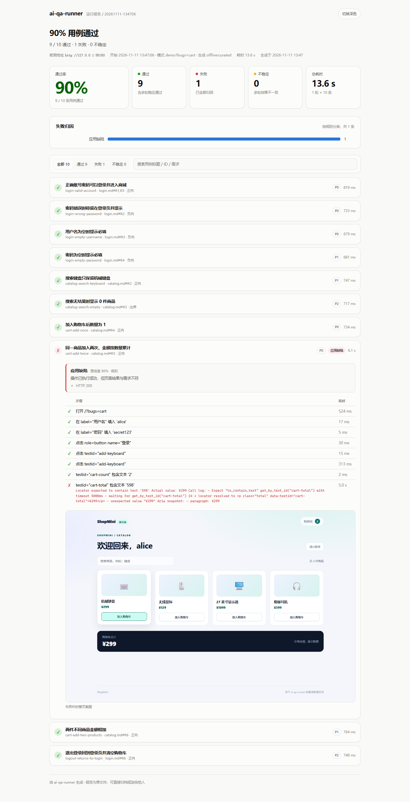

# ai-qa-runner

[](https://github.com/natorshzhong-netizen/ai-qa-runner/actions/workflows/ci.yml)

**把自然语言需求变成可执行、可归因、可重复的端到端测试。**

输入需求文档和被测页面，模型生成结构化用例 → schema 逐条校验 → Playwright 真实执行 → 规则归因失败 → 输出一份可归档的单文件 HTML 报告。



## 它解决什么问题

大多数「AI 写测试」停在生成一段代码：选择器是编的，跑挂了不知道为什么，结果没法比较。

这个项目多做三步：

1. **先看页面再写用例**：用 Playwright 抓取真实的 role / label / testid；生成后再逐条比对，摘要里找不到的定位器会被标出来。
2. **先过 schema 再执行**：动作、定位器、断言都有严格结构；不合法的用例带着错误信息回炉重写，而不是悄悄跳过。
3. **失败必须归类**：每条失败都给出 `应用缺陷 / 定位失效 / 用例错误 / 环境问题 / flaky`，并附截图、控制台错误和失败请求作为证据。

> 自带一个可离线运行的演示商城（`demo-app/`），不配 API Key、不连外网也能完整跑一遍。

## 快速开始

```bash
python -m venv .venv

# Windows Git Bash
source .venv/Scripts/activate
# Windows PowerShell
.venv\Scripts\Activate.ps1
# Windows cmd
.venv\Scripts\activate.bat
# macOS / Linux
source .venv/bin/activate

pip install -r requirements.txt
python -m playwright install chromium
python -m src.cli demo --open
```

> Windows 也可以直接双击 `start.bat`：自动建虚拟环境、装依赖、跑 demo。

`demo` 会自动托管演示商城、执行 `cases/demo-shop.json` 里的 10 条用例，并打开报告。

想看不通过时长什么样，给演示站注入一个真实缺陷：

```bash
python -m src.cli demo --bugs cart
```

购物车合计会忽略数量，`cart-add-twice` 失败并被归因为**应用缺陷**。

## 从需求生成用例

```bash
# 终端 1：启动演示站（默认 8000）
python -m src.cli serve --port 8000

# 终端 2：先探测页面真实元素，再让模型生成
python -m src.cli generate \
  --req requirements/catalog.md \
  --url http://127.0.0.1:8000 \
  --out cases/generated.json

# 执行
python -m src.cli run --cases cases/generated.json --serve demo-app --open
```

> 生成时如果连不上 `--url`，会打印警告并退回「只按需求生成」；也可以加 `--no-outline` 明确跳过探测。

模型选择按以下顺序自动决定：`--provider` 显式指定 → `DEEPSEEK_API_KEY` → `OPENAI_API_KEY` → 本机 Ollama → offline。

```bash
export DEEPSEEK_API_KEY=sk-...          # 云端
# 或
ollama serve                            # 本地，默认 qwen2.5-coder:7b
```

没有任何模型时，`generate --provider offline` 会直接读取 `cases/demo-shop.json`，保证流程可复现。

## 报告里有什么

- 通过率、通过/失败/不稳定、总耗时
- 失败归因分布（按规则分类）
- 每条用例的逐步骤结果与耗时
- 失败时的整页截图、页面异常、控制台错误、失败请求
- 可选 Playwright `trace.zip`，可在 `playwright show-trace` 里回放
- 状态筛选与关键字搜索；明暗主题；单文件，无外部依赖

## 评测

```bash
python eval/run_eval.py
```

| 指标 | 结果 | 说明 |
|---|---|---|
| schema 有效性判定 | 25 / 25 · 100% | 11 条合法 + 14 条非法，精确率/召回率均 100% |
| 失败归因规则 | 15 / 15 · 100% | 覆盖导航、真实 500 页面、定位超时、断言、请求失败、未知类型 |
| 干净套件 | 10 / 10 · 100% | 演示站默认无缺陷 |
| 注入缺陷归因 | 6 / 6 · 100% | 3 个应用 bug + 1 个定位失效 + 1 个不可达地址 + 1 个真实 500 页面 |

> 这些是仓库自带的小型回归集，不是公开 benchmark。数字用于证明「改动没有退化」，不代表通用模型效果。运行环境：Windows 11、Python 3.14、Playwright 1.65；干净套件在本机约 8–9 秒，失败用例会等到断言超时，耗时会变长。

### 真实模型实测

不只用离线用例，仓库里也保留了本地模型的一次真实产出（`cases/llm-generated-login.json`，未手工修改）：

| 项目 | 结果 |
|---|---|
| 模型 | Ollama `qwen2.5-coder:7b`，输入 `requirements/login.md` + 页面可达性摘要 |
| 生成 | 5 条，耗时约 44 秒，1 轮通过 schema |
| schema 合法 | 5 / 5 |
| 直接执行通过 | 4 / 5 |
| 失败的那条 | 退出登录用例漏了「先登录」，页面找不到按钮；被归因为**定位失效 / 用例错误**，没有误报成应用缺陷 |

这条失败用例被刻意保留下来：它说明归因链路能区分「应用坏了」和「用例写错了」。

测试与静态检查：

```bash
python -m pytest -q        # 43 个测试，含真实浏览器 E2E
ruff check . && ruff format --check .
```

## 架构

```text
requirements/*.md
      │
      ▼  ① capture_outline()：先抓页面上真实存在的元素
页面可达性摘要（role / label / testid / 可见文本）
      │
      ▼  ② generate.py：LLM → JSON → schema 校验 → 带错误信息修复
cases/*.json
      │
      ▼  ③ executor.py：Playwright 执行，逐步留证据
      ├── 截图（失败整页）
      ├── console / pageerror / requestfailed
      ├── trace.zip（可选）
      └── error_kind（timeout / assertion / navigation / action）
      │
      ▼  ④ diagnosis.py：确定性规则优先，模型只补一句根因提示
      │
      ▼  ⑤ report.py：自包含 HTML，可直接归档或转发
```

## 关键设计决策

### 1. 生成前先探测页面，而不是让模型猜选择器

`outline.py` 打开目标页，收集可交互元素的 `role`、标签、`placeholder`、`data-testid` 和标题结构，压成一段紧凑摘要放进提示词；生成后再用同一份摘要核对每个定位器，找不到的会作为 warning 打印出来。提示词里明确要求「摘要里没有的元素不要编造」，核对负责把不听劝的输出暴露出来。

> 核对只警告、不拒绝：摘要只覆盖一个页面状态，登录后的元素本来就不在登录页的摘要里。

### 2. 用例是数据，不是代码

模型输出的是受 schema 约束的 JSON（`goto / fill / click / press / expect_*` 九种动作）。好处是：可以逐条校验、可以统计有效率、可以在不信任模型的情况下安全执行。`extra="forbid"` 让模型多写的字段直接暴露，而不是被静默忽略。

### 3. 归因先规则，后模型

同一个失败信号必须得到同一个分类，才能进评测集。规则只看执行器给出的事实：异常类型、HTTP 状态、页面脚本错误、失败请求。例如：

| 事实 | 归因 |
|---|---|
| `goto` 报 `ERR_CONNECTION_REFUSED` | 环境 / 网络 |
| 页面返回 HTTP 5xx | 应用缺陷 |
| 点击超时，且页面脚本没有报错 | 定位失效或用例写错 |
| 点击超时，但页面抛了 `TypeError` | 应用缺陷（元素没渲染出来） |
| 操作成功，断言结果不符 | 应用缺陷 |
| 操作成功，但关键请求失败 | 先归环境，避免误报应用 |

`--llm-diagnose` 只会在规则结论后补一句人话，不改变分类。

### 4. 失败必须带证据

没有截图的失败报告等于让人重跑一遍。执行器在失败时保存整页截图，同时记录页面异常、控制台错误和失败请求；需要更细的现场时加 `--trace`，用 Playwright Trace Viewer 回放每一步。报告把截图转成 base64 内嵌，单文件发给别人也能看。

### 5. flaky 用重复执行定义，而不是感觉

`--repeat 3` 会把同一用例跑三轮：全过 = 通过，全挂 = 失败，有输有赢 = 不稳定，并保留第一次失败作为证据。演示站的 `?bugs=flaky` 会让「加入购物车」以 45% 概率静默失败，可以用来看效果：

```bash
python -m src.cli demo --bugs flaky --repeat 3
```

## 目录

```text
ai-qa-runner/
├── demo-app/            # 离线被测商城，?bugs= 注入缺陷
├── requirements/        # 自然语言需求
├── cases/demo-shop.json # 10 条人工校验过的固定用例
├── src/
│   ├── schema.py        # 用例结构与语义校验
│   ├── generate.py      # 生成 + 修复循环
│   ├── outline.py       # 页面可达性探测
│   ├── executor.py      # Playwright 执行与证据收集
│   ├── diagnosis.py     # 规则归因
│   ├── report.py        # 单文件 HTML 报告
│   ├── llm.py           # DeepSeek / OpenAI 兼容 / Ollama
│   └── cli.py           # demo / generate / run / serve
├── eval/                # 有效性 + 归因 + 真实执行评测
├── tests/               # 43 个测试
└── .github/workflows/ci.yml
```

## 局限

- 生成质量取决于模型；仓库自带离线用例，但没有 key 时无法验证「生成」这条链路。
- 归因规则覆盖的是常见失败形态，遇到新类型会落到「未归类」，需要人工看 trace 后补规则。
- 目前的动作集只覆盖单页交互（导航、输入、点击、断言），没有文件上传、iframe、多标签页和登录态复用。
- 演示站的缺陷是人工注入的，用于验证归因链路；不代表真实项目的缺陷分布。

## License

MIT © 2026 钟诚
